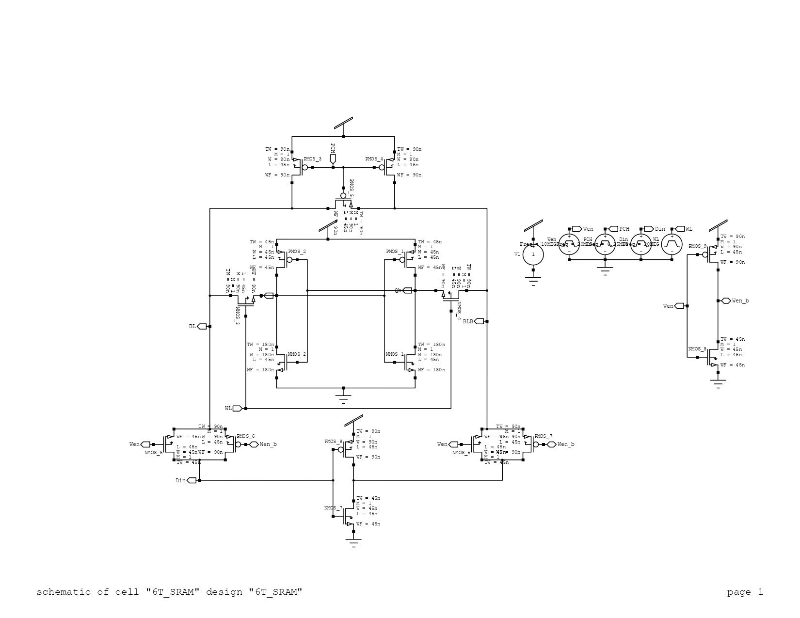
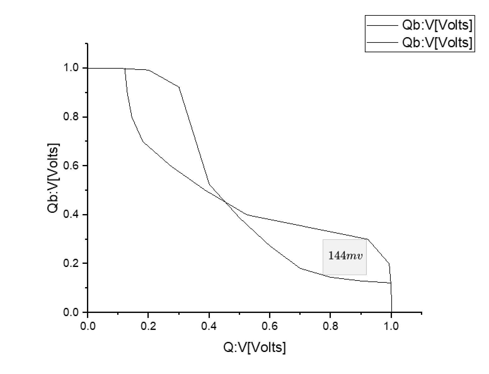
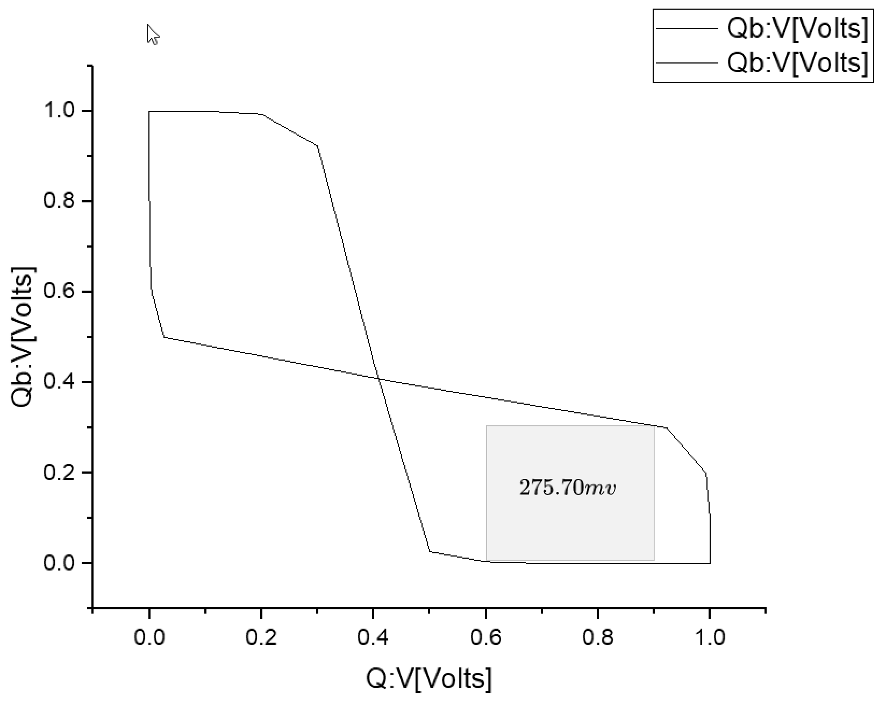

# 6T SRAM: the baseline cell

Part of a summer research internship at NIT Rourkela (May to July 2024, under Dr. Atin Mukherjee). The full
write-up, comparing this cell with the radiation-hardened HP16T and the HP13T experiment, is in
[HP13T-fault-tolerance-SRAM-cell](https://github.com/JaiminKadiwal/HP13T-fault-tolerance-SRAM-cell).

A conventional 6-transistor SRAM cell in 45 nm CMOS, built in Tanner S-Edit and simulated in T-Spice 16.3. It
gives the reference numbers the hardened cells are compared against: it is the fastest to read but has no
protection against a particle strike flipping the stored bit.

## Results (VDD = 1 V)

| Read access | Write access | Static power | Dynamic power | Read SNM | Hold SNM |
|---|---|---|---|---|---|
| 6.46 ps | 189.35 ps | 21.80 nW | 115.94 nW | 144 mV | 275.70 mV |

| Schematic | Read SNM (butterfly) | Hold SNM (butterfly) |
|---|---|---|
|  |  |  |

Read and write waveforms: [docs/read_write_waveform.png](docs/read_write_waveform.png).

## Files

`6T_SRAM/` holds the Tanner S-Edit project: open `6T_SRAM.tanner` in Tanner Tools 16.3. `design.edif` is the
schematic netlist.
